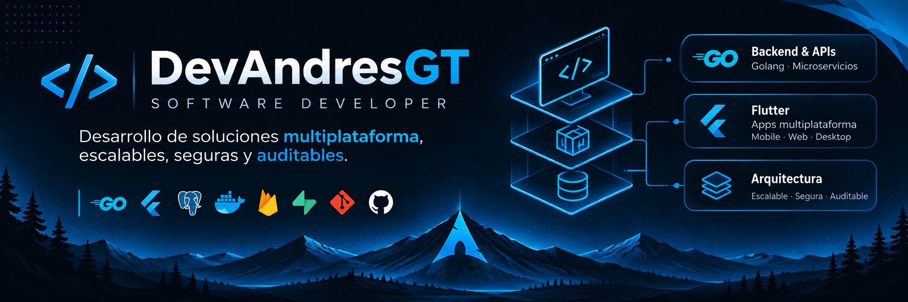

### 👋 ¡Hola! Soy DevAndresGT

**Desarrollador de software | Go · Flutter · Arquitectura de software**

Construyo soluciones multiplataforma con especial atención a la **seguridad, trazabilidad, rendimiento y mantenibilidad**.

---

## 👨‍💻 Sobre mí

Me especializo en el desarrollo de **aplicaciones multiplataforma** y **servicios backend**, con interés en sistemas auditables y arquitecturas que puedan evolucionar sin perder claridad ni control sobre los datos.

- 🔭 **En qué trabajo:** proyectos del ecosistema **Escalabres / Nexunid** y herramientas para Go.
- ⚙️ **Backend:** APIs REST, autenticación, middleware, persistencia y diseño modular.
- 📱 **Multiplataforma:** aplicaciones móviles, web y escritorio con Flutter.
- 🔐 **Lo que priorizo:** seguridad, trazabilidad, integridad de datos y observabilidad.
- 🌱 **En aprendizaje constante:** arquitectura de software y sistemas distribuidos.
- 🐧 **Mi entorno:** Arch Linux, Git y herramientas de desarrollo.

## 🛠️ Tecnologías

**Lenguajes**

**Frameworks y backend**

**Datos y servicios**

**Herramientas**

---

## 🚀 Proyectos destacados

### ⚡ Goxis — Ecosistema de desarrollo en Go

Proyecto enfocado en explorar y construir herramientas reutilizables para el desarrollo en **Go**, con énfasis en modularidad, mantenibilidad y buenas prácticas.

**Enfoque:** herramientas para desarrolladores · componentes reutilizables · Go

### 🧩 [GoKit — Utilidades para Go](https://github.com/AndresGT/GoKit)

Conjunto de herramientas para simplificar tareas habituales en aplicaciones backend, incluyendo **logging, middleware, seguridad y gestión de rutas**.

**Stack:** Go

### 📱 Nexunid — Plataforma multiplataforma

Plataforma orientada a la gestión de contactos y relaciones, con clientes multiplataforma e integración mediante servicios backend.

**Stack:** Flutter · Dart · APIs REST

### ⚙️ Nexunid API — Backend en Go

Servicios backend orientados a la gestión de datos y operaciones, con énfasis en autenticación, arquitectura modular y trazabilidad.

**Stack:** Go · PostgreSQL · REST

---

## 🎯 Principios de desarrollo

- **Seguridad desde el diseño:** proteger los datos y controlar el acceso.
- **Trazabilidad:** facilitar el seguimiento de operaciones y cambios.
- **Arquitectura mantenible:** favorecer componentes claros, modulares y reutilizables.
- **Rendimiento:** utilizar los recursos de forma eficiente.
- **Mejora continua:** aprender, medir y evolucionar las soluciones.

## 📊 Actividad en GitHub

> Las tarjetas de estadísticas son servicios externos y podrían no mostrarse temporalmente.

---

### 🤝 ¿Colaboramos?

Si tienes una idea o quieres conversar sobre **Go, Flutter o arquitectura de software**, puedes contactarme.

[Portafolio](https://devandresgt.lat) · [LinkedIn](https://www.linkedin.com/in/DevAndresGT) · [Correo](mailto:diegogiraldo506@gmail.com) · [X / Twitter](https://twitter.com/DevAndresGT)

*«El código es mi pasión; la seguridad, la auditoría y la trazabilidad son parte de mi forma de construir software».*

